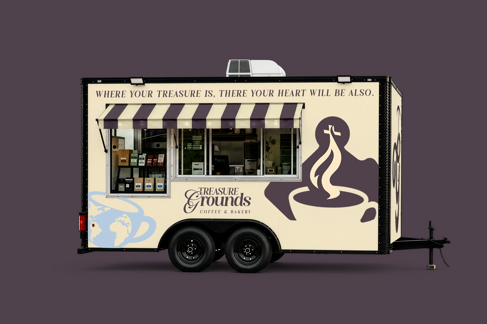

# Treasure Grounds

### Coffee, bakery, and Colombian roots — brought together in a warm digital experience.

[Visit the live website](https://treasuregrounds.us)

## The experience

Treasure Grounds is a bilingual brand website created for a Colombian coffee and bakery concept. The experience combines an editorial layout, warm earthy tones, expressive typography, and subtle motion to reflect the character of the physical coffee trailer.

The site introduces the brand, showcases its menu, shares its Colombian roots, and helps visitors discover the experience in either English or Spanish.

## Highlights

- A cinematic hero with a one-time light and zoom entrance
- A responsive coffee and bakery menu with original product imagery
- English and Spanish experiences with dedicated localized metadata
- Subtle scroll reveals and tactile interactions
- Mobile-first layouts across the full site
- Search and social metadata, structured data, sitemap, and canonical URLs
- Optimized WebP imagery and a lightweight static build

## Visual direction

The interface takes inspiration from coffee packaging, independent bakeries, and editorial hospitality design. Plum, cream, and muted blue create a distinctive palette, while large type and generous imagery give the brand room to feel confident and memorable.

## Built with

Astro · Tailwind CSS · Lenis · HTML · CSS · JavaScript

**[treasuregrounds.us](https://treasuregrounds.us)**

